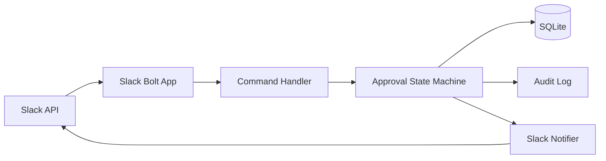

# ARCHITECTURE.md

## Component Diagram

## Components

| Component | Responsibility |
|---|---|
| Slack Bolt App | Verify Slack requests and route commands/actions |
| Command Handler | Convert Slack payloads into domain commands |
| Approval State Machine | Enforce legal transitions |
| SQLite Store | Persist requests and processed event IDs |
| Slack Notifier | Send result and error notifications |
| Audit Log | Record who changed what and when |

## Dependency Rule

Domain logic must not import Slack SDK objects. Handlers translate Slack payloads into domain commands before calling the state machine.

## Non-Functional Requirements

- Slash command acknowledgement must complete within 3 seconds
- Duplicate Slack event IDs must be treated idempotently
- Audit log retention is 180 days

