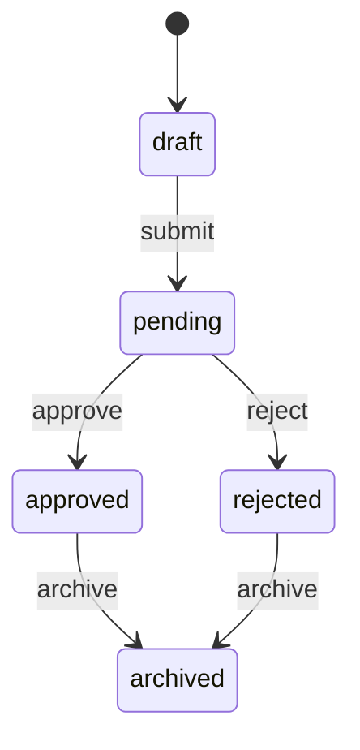

# DOMAIN.md

## Terms

| Term | Definition |
|---|---|
| Request | A business action submitted for approval |
| Requester | Slack user who submits a request |
| Approver | Slack user allowed to approve or reject |
| Substitute Approver | User allowed to act when the primary approver is unavailable |
| Audit Event | Immutable record of a state transition |

## State Machine

## Events

- `submit`: requester submits a draft
- `approve`: approver accepts a pending request
- `reject`: approver rejects a pending request with a reason
- `archive`: system archives a completed request

